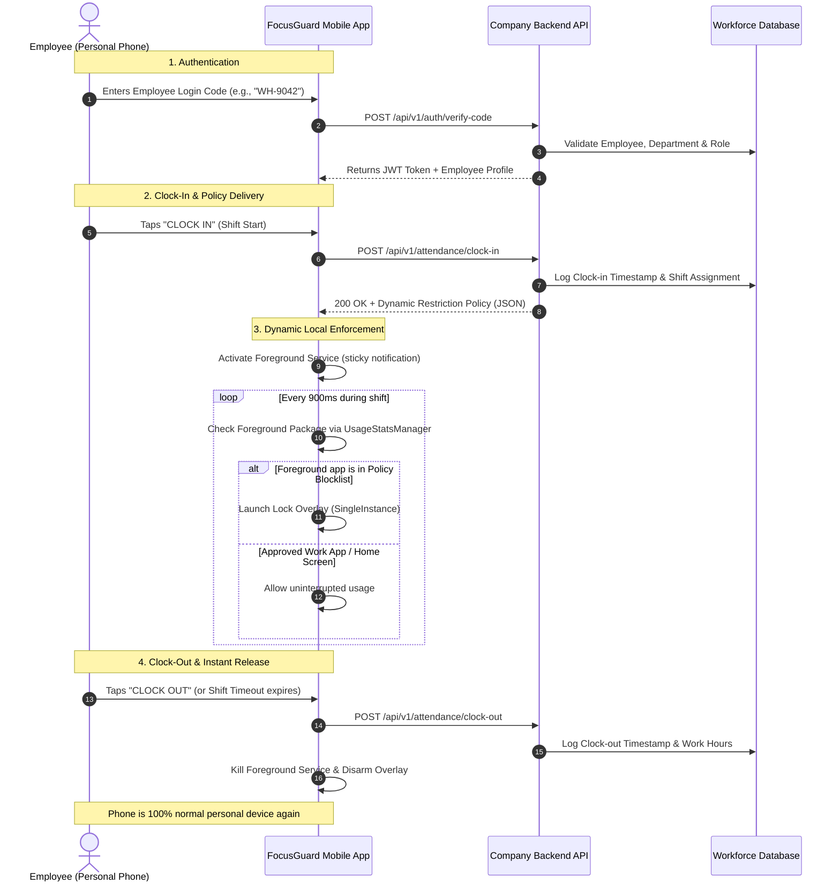
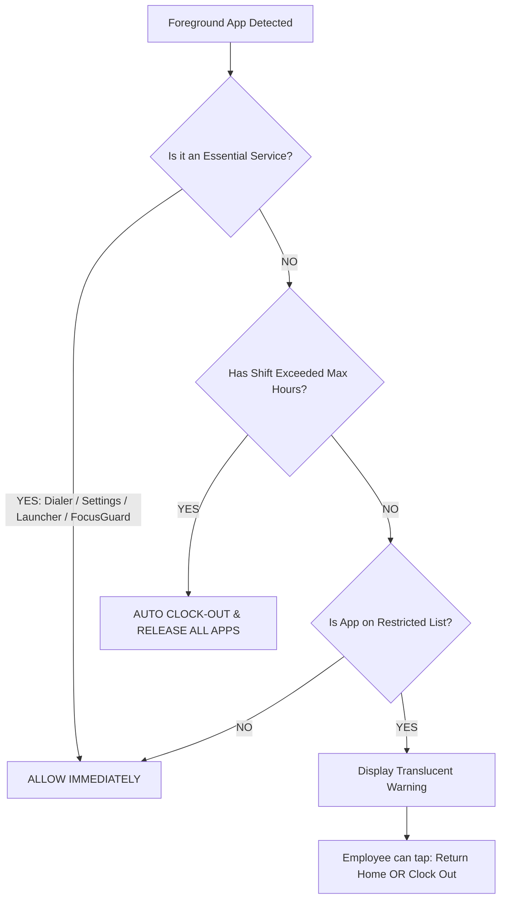

# Product Proposal: Non-MDM Workplace Attendance & App Restriction Architecture
**Document Version:** 1.0  
**Target Audience:** Product Supervisor, Engineering Lead, HR / Compliance Team  
**Focus Area:** Personal Devices (BYOD) Workforce Productivity & Privacy-Preserving App Restriction  

---

## 1. Executive Summary

Traditional workforce productivity tools face a severe dilemma when deployed on **personal mobile devices (BYOD)**:

- **Mobile Device Management (MDM)** solutions (like Microsoft Intune or VMware Workspace ONE) require invasive device administrator privileges, remote wipe authority, and device-level monitoring. Employees rightfully resist installing them on personal hardware due to privacy concerns.
- **Accessibility-based blockers** request permissions that can inspect personal banking, private messaging, and screen contents, triggering Play Store rejections, OS security warnings, and legal liabilities.

This document proposes a **lightweight, privacy-first alternative**: an attendance-based app restriction engine that:
1. Operates **strictly while the employee is timed in**.
2. Requires **zero MDM / zero device administrator rights**.
3. Uses **no Accessibility Service** (preventing any access to screen contents, keystrokes, or private messages).
4. Configures restrictions dynamically from the **company backend based on employee login codes and roles**.
5. Disables all restrictions the instant the shift ends or the employee clocks out.

---

## 2. Why MDM Fails for Personal Devices (BYOD)

If your product supervisor has concerns about MDM, their concerns are backed by industry reality:

```mermaid
graph TD
    subgraph MDM_Approach["Traditional MDM Approach"]
        A[Company buys MDM licenses] --> B[Demands employee enroll personal phone]
        B --> C[Employee sees: Remote Wipe, Full Device Monitoring]
        C --> D[Mass Employee Resistance / Refusal]
        D --> E[Legal & Labor Union Liability]
    end

    subgraph Proposed_Approach["Proposed FocusGuard Solution"]
        F[Employee installs simple attendance app] --> G[Logs in with employee code]
        G --> H[Privacy-preserved permissions: Usage Access only]
        H --> I[Restrictions active ONLY during shift]
        I --> J[100% Unrestricted personal phone off-the-clock]
    end
```



### Key Problems with MDM on Personal Phones:
| MDM Risk Factor | Impact on BYOD Workforce |
| :--- | :--- |
| **"Nuclear Option" Remote Wipe** | MDM profiles allow IT to remotely wipe the entire device. Employees fear losing personal family photos, chats, and banking apps. |
| **High Licensing Cost** | Enterprise MDMs cost **\$4 to \$10 per user per month** in recurring subscription fees. |
| **Certificate Inspection** | MDMs can route traffic through enterprise proxies, theoretically decrypting private traffic. |
| **Legal / Labor Law Violations** | In many jurisdictions (such as California, EU/GDPR, Philippines Labor Code), enforcing off-hours device restrictions or monitoring on personal assets exposes companies to labor lawsuits. |

---

## 3. The Solution: App-Level Enforcement (No MDM, No Accessibility)

Instead of controlling the entire operating system through MDM, the app uses two standard, user-transparent Android system APIs:

1. **`UsageStatsManager` (Usage Access)**:
   - Allows the app to query *which package is currently in the foreground* every 900ms.
   - **Zero access to screen pixels, text fields, keystrokes, camera, or app content.**
   - It only asks: *"Is the frontmost window TikTok or Slack?"*

2. **`SYSTEM_ALERT_WINDOW` (Display Over Other Apps)**:
   - When a restricted package is detected during an active shift, a friendly translucent overlay appears displaying:
     > *"This app is restricted during your attendance session. Please return to work tasks or clock out."*
   - Tapping "Go Back" returns the employee to their home screen or the company attendance portal.

---

## 4. End-to-End System Flow



---

## 5. Backend Policy Architecture (Role-Based Restriction)

Restrictions should **never be hardcoded** into the mobile APK. Instead, policies are defined in your company admin dashboard and fetched dynamically upon login or clock-in.

### Backend Data Structure:

```json
{
  "employee_id": "EMP-9042",
  "employee_name": "Marcus Vance",
  "department": "Inventory & Logistics",
  "role": "Warehouse Operator",
  "shift": {
    "shift_id": "SH-2026-11-13-A",
    "scheduled_end": "2026-11-13T17:00:00Z",
    "max_session_hours": 8.5
  },
  "restriction_policy": {
    "policy_id": "POL_WAREHOUSE_STRICT",
    "mode": "BLOCKLIST",
    "auto_detect_categories": {
      "block_all_games": true,
      "block_all_browsers": true
    },
    "blocked_packages": [
      "com.zhiliaoapp.musically",
      "com.ss.android.ugc.trill",
      "com.instagram.android",
      "com.facebook.katana",
      "com.twitter.android",
      "com.reddit.frontpage",
      "tv.twitch.android.app",
      "com.netflix.mediaclient"
    ],
    "exempt_packages": [
      "com.slack",
      "com.google.android.apps.messaging",
      "com.company.erp"
    ]
  }
}
```

### Why This Architecture Wins:
- **Zero App Updates Required**: When a new viral game or app emerges, HR or Operations adds the package name to the backend portal. All employee devices immediately adopt the new rule on their next shift.
- **Department Tailoring**:
  - *Field Technicians*: Can use Google Maps and Camera; games and social media blocked.
  - *Social Media Coordinators*: Can use Instagram/TikTok; games and personal browsers blocked.
  - *Call Center / Retail Staff*: Strict distraction-free profile.

---

## 6. Anti-Lockout Fail-Safes (Safety Guarantees)

One of the greatest fears for any product supervisor is: *"What if an employee or manager gets locked out of their personal phone?"*

The system implements **five hardware-level and software-level fail-safes**:



1. **Emergency & Dialer Immunity**:
   - The phone dialer (`Intent.ACTION_DIAL`) and emergency services (911, 112, 999) can **never** be blocked under any circumstances.
2. **Device Settings Immunity**:
   - `com.android.settings` is strictly whitelisted. Employees can always adjust WiFi, brightness, or manage phone accounts.
3. **Home Launcher Immunity**:
   - Any app declaring `Intent.CATEGORY_HOME` (system launcher) is protected, ensuring the phone navigation never freezes.
4. **Shift Dead-Man's Switch (Auto-Timeout)**:
   - If an employee leaves work and forgets to clock out, the service automatically deactivates after a configurable threshold (e.g., 8.5 hours).
5. **Direct Escape Hatch on Lock Screen**:
   - The lock overlay features an immediate **"Go to Attendance"** button allowing the user to clock out or request a break at any moment.

---

## 7. Comparative Analysis Matrix

| Feature | Enterprise MDM | Accessibility Blocker | **FocusGuard (Proposed)** |
| :--- | :---: | :---: | :---: |
| **BYOD / Personal Phone Friendly** | ❌ Extremely Hostile | ⚠️ Questionable | ✅ **100% Friendly** |
| **No Remote Device Wipe Ability** | ❌ Can wipe personal phone | ✅ Cannot wipe | ✅ **Cannot wipe** |
| **Privacy: Can Inspect Screen Content** | ⚠️ Can read device info | ❌ Reads all screen text/banking | ✅ **Zero access to screen/data** |
| **Works ONLY During Clocked-In Hours** | ❌ Always active 24/7 | ⚠️ Hard to orchestrate | ✅ **Active strictly while timed in** |
| **Play Store Policy Compliance** | ✅ Compliant (Admin API) | ❌ Frequently rejected | ✅ **Fully compliant (Special Use FGS)** |
| **Monthly Software Licensing Fees** | ❌ \$4–\$10/user/month | ❌ Commercial SDK fee | ✅ **\$0 (In-house owned architecture)** |
| **Dynamic Backend Policy by Role** | ⚠️ Requires MDM profiles | ⚠️ Limited | ✅ **Native JSON REST API** |

---

## 8. Summary & Recommendation for Product Leadership

> **Key Takeaway for Management:**  
> This proposed architecture achieves **100% of the operational objective** (preventing TikTok, Instagram, gaming, and web surfing while on company time) with **0% of the legal, financial, and cultural baggage of MDM**.

- **Employees accept it** because it is completely transparent, does not inspect their private texts or bank accounts, and completely deactivates when their shift ends.
- **Operations gains full flexibility** through dynamic, role-based restriction policies delivered from your existing backend database.
- **The company avoids recurring enterprise MDM license fees** while retaining full intellectual property ownership of the attendance solution.
